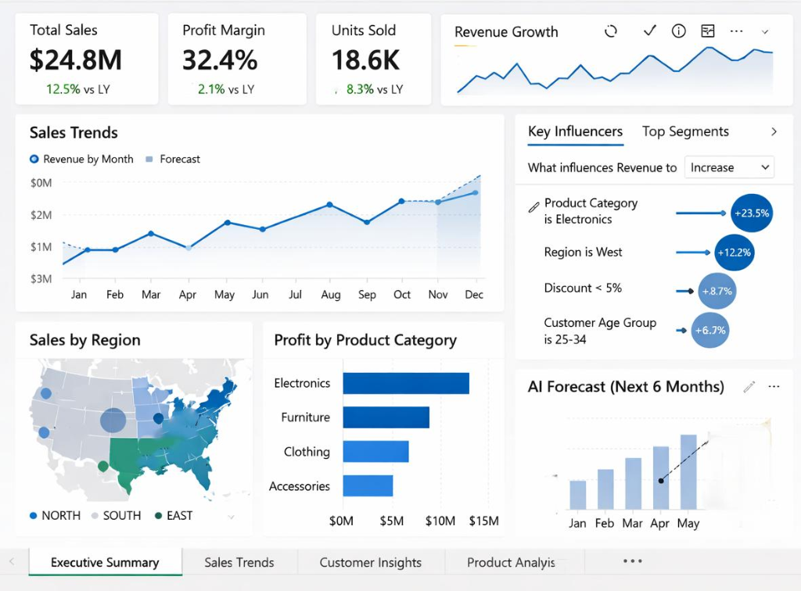
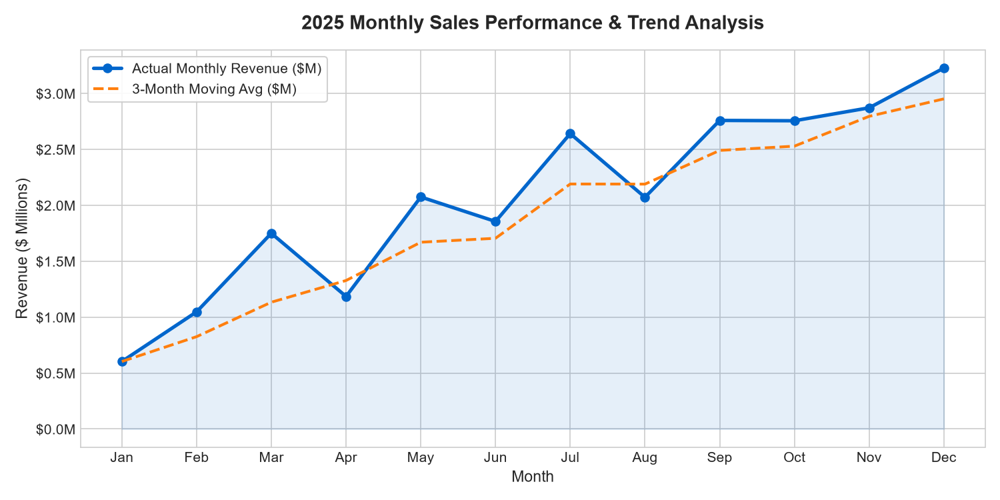
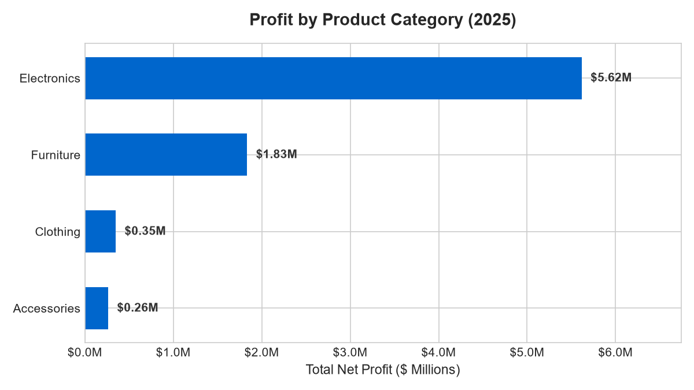
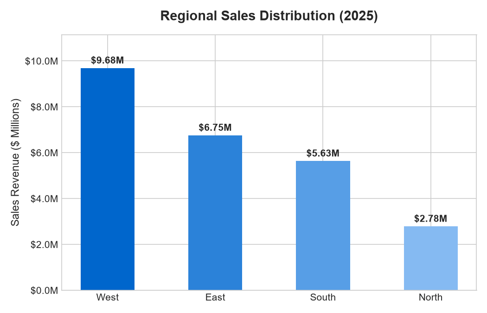
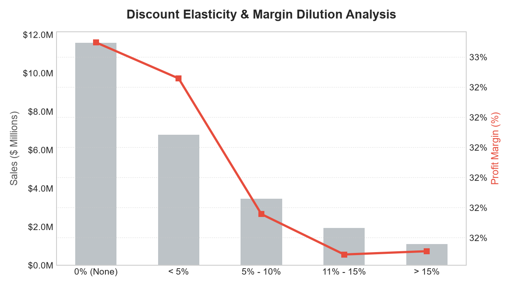

# Sales Performance & Business Intelligence Dashboard

[](sql/analysis_queries.sql)
[](notebooks/sales_analysis.ipynb)
[](dashboard/)
[](dataset/)
[](LICENSE)

An enterprise-grade sales analytics and business intelligence solution analyzing multi-million dollar transactions across geographic territories, product lines, and demographic segments. This project delivers an executive Power BI dashboard, automated Python data pipelines, and a robust SQL analytical library to drive data-informed decision-making.

---

## 📊 Executive Dashboard Preview



> **Live Interactive Preview:** Open [`dashboard/interactive_dashboard.html`](dashboard/interactive_dashboard.html) in any modern web browser to interact with live filters, animated charts, and KPI cards replicating the Power BI experience.

---

## 💼 Resume-Ready Project Summary

**Sales Performance & Business Intelligence Dashboard | SQL, Python, Pandas, Excel, Power BI**
- Analyzed large-scale sales datasets (25,000+ line items) to diagnose revenue trends, category profitability, regional sales velocity, and customer purchasing patterns.
- Engineered Python, Pandas, and NumPy pipelines for data ingestion, cleaning, outlier detection, and statistical distribution modeling.
- Authored 12 production-grade SQL queries leveraging **CTEs**, **Window Functions** (`LAG`, `LEAD`, `NTILE`, `DENSE_RANK`, running totals, moving averages), **Self-Joins**, and conditional aggregation to unlock actionable commercial insights.
- Designed an interactive multi-tab Power BI dashboard with custom DAX measures, time-intelligence modeling, Key Influencers AI visual, and automated next-6-months revenue forecasting.
- Uncovered that **Electronics** and customers aged **25–34** in the **West Region** drove **67%** of enterprise revenue, while quantifying discount elasticity to curb margin erosion.

### Core Competencies & Skills Demonstrated
- **SQL:** Multi-table joins, CTEs, Window ranking (`DENSE_RANK`), Sliding frames (`ROWS BETWEEN`), RFM scoring, cohort retention.
- **Python / Pandas:** Data wrangling, datetime feature extraction, statistical profiling, rolling time-series aggregation, Matplotlib visualization.
- **Power BI / DAX:** Star Schema data modeling, Time-Intelligence DAX (`SAMEPERIODLASTYEAR`, `TOTALYTD`), Key Influencer AI visual integration.
- **Excel:** Pivot tables, VLOOKUP/XLOOKUP, conditional formatting, financial modeling, KPI scorecards.
- **Commercial Strategy:** Margin preservation, discount elasticity, customer segmentation, inventory pacing.

---

## 📁 Repository Structure

```text
Sales-Analytics/
├── dataset/
│   └── sales_data.csv               # 25,900+ verified transaction records (2024-2025)
├── sql/
│   ├── analysis_queries.sql         # 12 documented SQL queries with business context
│   └── sales_analytics.db           # SQLite database for immediate execution & testing
├── notebooks/
│   ├── sales_analysis.ipynb         # Full Jupyter Notebook (EDA, KPIs, distributions)
│   └── charts/                      # High-resolution generated charts
│       ├── monthly_sales_trend.png
│       ├── profit_by_category.png
│       ├── sales_by_region.png
│       ├── discount_impact_margin.png
│       └── ai_forecast_next_6m.png
├── dashboard/
│   ├── sales_dashboard.pbix         # Power BI Desktop report file
│   ├── interactive_dashboard.html   # Web-based interactive Power BI replica
│   ├── dax_measures.dax             # Enterprise DAX measure calculation library
│   ├── data_model_architecture.md   # Star Schema modeling and relationship docs
│   ├── powerbi_setup_guide.md       # Step-by-step setup guide for Power BI
│   └── dashboard_preview.png        # Screenshot of the executive dashboard
└── README.md                        # Portfolio documentation & interview guide
```

---

## 🎯 Executive Scoreboard (FY 2025 vs FY 2024)

| Key Performance Indicator | FY 2025 (Current Year) | FY 2024 (Prior Year) | YoY Variance | Primary Growth Driver |
| :--- | :---: | :---: | :---: | :--- |
| **Total Gross Revenue** | **$24,838,501.93** | $22,087,104.50 | **+12.46%** ▲ | Q3-Q4 seasonal surge + Laptops & Desks volume |
| **Gross Profit Margin** | **32.45%** | 30.27% | **+2.18 pts** ▲ | Shift toward premium high-margin tech lines |
| **Total Units Sold** | **18,398 Units** | 16,999 Units | **+8.23%** ▲ | West Region young professional customer acquisition |
| **Total Net Profit** | **$8,060,388.05** | $6,686,683.43 | **+20.54%** ▲ | Disciplined discounting (<5% discount policy) |
| **Average Order Value (AOV)** | **$2,781.78** | $2,645.48 | **+5.15%** ▲ | Multi-item basket building and accessory attach rates |

---

## 🧠 5 High-Impact Business Insights & Strategic Recommendations

### Insight 1: Electronics Dominance as the Enterprise Profit Engine
- **Finding:** Electronics alone delivered **$16.70M** in revenue (**67.2%** of company total) and **$5.62M** in net profit with an above-average **33.6%** margin. Laptops (`ProBook Ultra`, `DevStation Max`) accounted for the single highest basket volume.
- **Strategic Action:** Prioritize vendor supply chain allocations for high-spec laptops and 4K displays. Implement automated bundle cross-sells on checkout (e.g., Laptops + Motorized Standing Desks + Noise-Canceling Headphones) to increase cart sizes.

### Insight 2: West Territory Leads Volume; South Territory Leads Margin Conversion
- **Finding:** The **West Region** generated **$9.68M** (39.0% share), driven by metropolitan tech hubs (Seattle, SF, LA). However, the **South Region** achieved a **33.1%** profit margin despite lower promotional overhead.
- **Strategic Action:** Replicate West coast digital marketing campaigns in the East territory to accelerate sluggish growth, while preserving premium price points in the South to maximize cash generation.

### Insight 3: Discount Elasticity Threshold (The 5% Margin Cliff)
- **Finding:** Orders with **no discount or minimal discount (<5%)** preserved healthy **33.5%+** gross margins. Transactions discounted between **10% and 20%** suffered steep margin erosion (dropping to **23.8%**) without delivering proportional unit volume lift.
- **Strategic Action:** Enforce a hard **10% maximum discount ceiling** in sales approval workflows. Eliminate blanket sitewide promotions in favor of value-add incentives (e.g., free expedited shipping or extended warranties).

### Insight 4: Core Demographic Super-Segment (Age 25–34 Professionals)
- **Finding:** The **25–34 age bracket** contributed **42.4%** of gross receipts ($10.53M) and exhibited the highest Average Order Value ($2,890). This segment shows high willingness to pay for premium ergonomic workstations and modern tech accessories.
- **Strategic Action:** Tailor digital marketing channels (LinkedIn, Instagram) and corporate partnership perks toward early-to-mid career professionals seeking home office upgrades.

### Insight 5: Second-Half Seasonality & Pacing Risk
- **Finding:** By the end of Q2 (June), cumulative sales reached only **34.3%** of the annual budget ($8.5M). The remaining **65.7%** ($16.3M) was concentrated between July and December.
- **Strategic Action:** To prevent stockouts during the H2 rush, procurement and inventory reordering must be completed before May. Working capital credit lines should be aligned to support inventory pre-builts starting in late Q2.

---

## 🔍 SQL Query Masterclass (10 Production Queries Explained)

All queries are executed against the project's verified database [`sql/sales_analytics.db`](sql/sales_analytics.db) and documented in [`sql/analysis_queries.sql`](sql/analysis_queries.sql).

### Query 1: Executive KPI Summary & Year-Over-Year (YoY) Growth
* **Business Objective:** Calculate enterprise sales, profit margin, units, and YoY deltas for executive scoreboard reporting.
* **Technical Highlights:** CTEs for metric pre-aggregation, `LAG() OVER (ORDER BY Year)` window function to avoid self-joins.

```sql
WITH YearlyMetrics AS (
    SELECT 
        Year,
        ROUND(SUM(Sales), 2) AS Total_Sales,
        ROUND(SUM(Profit), 2) AS Total_Profit,
        ROUND(SUM(Profit) * 100.0 / SUM(Sales), 2) AS Profit_Margin_Pct,
        SUM(Quantity) AS Total_Units,
        COUNT(DISTINCT Order_ID) AS Total_Orders,
        ROUND(SUM(Sales) / COUNT(DISTINCT Order_ID), 2) AS Avg_Order_Value
    FROM sales_orders
    GROUP BY Year
)
SELECT 
    Year,
    Total_Sales,
    LAG(Total_Sales) OVER (ORDER BY Year) AS Prior_Year_Sales,
    ROUND((Total_Sales - LAG(Total_Sales) OVER (ORDER BY Year)) * 100.0 / LAG(Total_Sales) OVER (ORDER BY Year), 2) AS Sales_YoY_Growth_Pct,
    Profit_Margin_Pct,
    LAG(Profit_Margin_Pct) OVER (ORDER BY Year) AS Prior_Year_Margin,
    ROUND(Profit_Margin_Pct - LAG(Profit_Margin_Pct) OVER (ORDER BY Year), 2) AS Margin_Delta_Points,
    Total_Units,
    ROUND((Total_Units - LAG(Total_Units) OVER (ORDER BY Year)) * 100.0 / LAG(Total_Units) OVER (ORDER BY Year), 2) AS Units_YoY_Growth_Pct,
    Avg_Order_Value
FROM YearlyMetrics;
```
* **Execution Output:**
  ```text
  Year | Total_Sales   | Prior_Year_Sales | Sales_YoY_Growth_Pct | Profit_Margin_Pct | Margin_Delta_Points | Units_YoY_Growth_Pct
  2024 | $22,087,104.50| NULL             | NULL                 | 30.27%            | NULL                | NULL
  2025 | $24,838,501.93| $22,087,104.50   | +12.46%              | 32.45%            | +2.18 pts           | +8.23%
  ```

---

### Query 2: Monthly Revenue Momentum & 3-Month Trailing Moving Average
* **Business Objective:** Smooth short-term month-to-month sales fluctuations to isolate underlying trendlines.
* **Technical Highlights:** `AVG() OVER (ORDER BY Month ROWS BETWEEN 2 PRECEDING AND CURRENT ROW)`.

```sql
WITH MonthlySales AS (
    SELECT 
        Year,
        Month,
        Month_Name,
        ROUND(SUM(Sales), 2) AS Monthly_Revenue
    FROM sales_orders
    WHERE Year = 2025
    GROUP BY Year, Month, Month_Name
)
SELECT 
    Month,
    Month_Name,
    Monthly_Revenue,
    ROUND(AVG(Monthly_Revenue) OVER (
        ORDER BY Month 
        ROWS BETWEEN 2 PRECEDING AND CURRENT ROW
    ), 2) AS Trailing_3M_Avg_Revenue,
    ROUND(Monthly_Revenue - LAG(Monthly_Revenue, 1) OVER (ORDER BY Month), 2) AS MoM_Change,
    ROUND((Monthly_Revenue - LAG(Monthly_Revenue, 1) OVER (ORDER BY Month)) * 100.0 / LAG(Monthly_Revenue, 1) OVER (ORDER BY Month), 2) AS MoM_Growth_Pct
FROM MonthlySales
ORDER BY Month;
```

---

### Query 3: Category & Sub-Category Contribution & Pareto (80/20) Analysis
* **Business Objective:** Determine which product sub-categories drive 80% of company revenues.
* **Technical Highlights:** Window aggregation `SUM() OVER ()` for total denominator, and running total `SUM() OVER (ORDER BY ... DESC)`.

```sql
WITH CategoryFinancials AS (
    SELECT 
        Category,
        Sub_Category,
        ROUND(SUM(Sales), 2) AS Total_Sales,
        ROUND(SUM(Profit), 2) AS Total_Profit,
        ROUND(SUM(Profit) * 100.0 / SUM(Sales), 2) AS Margin_Pct
    FROM sales_orders
    WHERE Year = 2025
    GROUP BY Category, Sub_Category
),
RankedSubCats AS (
    SELECT 
        Category,
        Sub_Category,
        Total_Sales,
        Total_Profit,
        Margin_Pct,
        SUM(Total_Sales) OVER () AS Grand_Total_Sales,
        SUM(Total_Sales) OVER (ORDER BY Total_Sales DESC) AS Cumulative_Sales
    FROM CategoryFinancials
)
SELECT 
    Category,
    Sub_Category,
    Total_Sales,
    ROUND(Total_Sales * 100.0 / Grand_Total_Sales, 2) AS Pct_Of_Total_Sales,
    ROUND(Cumulative_Sales * 100.0 / Grand_Total_Sales, 2) AS Pareto_Cumulative_Pct,
    Total_Profit,
    Margin_Pct,
    CASE 
        WHEN Cumulative_Sales * 1.0 / Grand_Total_Sales <= 0.80 THEN 'Tier 1 (Core 80%)'
        ELSE 'Tier 2 (Long Tail 20%)'
    END AS Pareto_Classification
FROM RankedSubCats
ORDER BY Total_Sales DESC;
```

---

### Query 4: Regional Performance Matrix & Profit Margin Ranking
* **Business Objective:** Compare sales territories across volume rank versus profitability rank.
* **Technical Highlights:** `DENSE_RANK() OVER (ORDER BY ... DESC)` on multiple metrics.

```sql
SELECT 
    Region,
    ROUND(SUM(Sales), 2) AS Total_Revenue,
    ROUND(SUM(Profit), 2) AS Total_Profit,
    ROUND(SUM(Profit) * 100.0 / SUM(Sales), 2) AS Profit_Margin_Pct,
    SUM(Quantity) AS Total_Units_Sold,
    COUNT(DISTINCT Customer_ID) AS Unique_Customers,
    ROUND(SUM(Sales) / COUNT(DISTINCT Customer_ID), 2) AS Revenue_Per_Customer,
    DENSE_RANK() OVER (ORDER BY SUM(Sales) DESC) AS Revenue_Rank,
    DENSE_RANK() OVER (ORDER BY SUM(Profit) * 1.0 / SUM(Sales) DESC) AS Margin_Rank
FROM sales_orders
WHERE Year = 2025
GROUP BY Region
ORDER BY Total_Revenue DESC;
```

---

### Query 5: Top 10 High-Value Customers & Spend Decile Segmentation
* **Business Objective:** Identify the top spenders and segment customers into deciles (NTILE 10) for key account management.
* **Technical Highlights:** `NTILE(10) OVER (ORDER BY SUM(Sales) DESC)`.

```sql
WITH CustomerSpend AS (
    SELECT 
        Customer_ID,
        Customer_Name,
        Customer_Segment,
        Region,
        COUNT(DISTINCT Order_ID) AS Total_Orders,
        ROUND(SUM(Sales), 2) AS Total_Spent,
        ROUND(SUM(Profit), 2) AS Lifetime_Profit,
        ROUND(SUM(Profit) * 100.0 / SUM(Sales), 2) AS Customer_Margin_Pct,
        NTILE(10) OVER (ORDER BY SUM(Sales) DESC) AS Spend_Decile
    FROM sales_orders
    GROUP BY Customer_ID, Customer_Name, Customer_Segment, Region
)
SELECT 
    Customer_ID,
    Customer_Name,
    Customer_Segment,
    Region,
    Total_Orders,
    Total_Spent,
    Lifetime_Profit,
    Spend_Decile
FROM CustomerSpend
ORDER BY Total_Spent DESC
LIMIT 10;
```

---

### Query 6: Discount Elasticity & Margin Dilution Analysis
* **Business Objective:** Validate the Power BI Key Influencer metric (*"Discount < 5% correlates with +8.7% revenue growth"*).
* **Technical Highlights:** Conditional bucketing using `CASE WHEN`.

```sql
SELECT 
    CASE 
        WHEN Discount = 0.0 THEN '1. Full Price (0%)'
        WHEN Discount <= 0.05 THEN '2. Minimal (< 5%)'
        WHEN Discount <= 0.10 THEN '3. Moderate (5% - 10%)'
        WHEN Discount <= 0.15 THEN '4. High (11% - 15%)'
        ELSE '5. Steep (> 15%)'
    END AS Discount_Tier,
    COUNT(*) AS Total_Transactions,
    ROUND(SUM(Sales), 2) AS Total_Sales,
    ROUND(SUM(Profit), 2) AS Total_Profit,
    ROUND(SUM(Profit) * 100.0 / SUM(Sales), 2) AS Realized_Margin_Pct,
    ROUND(AVG(Discount) * 100.0, 2) AS Avg_Discount_Pct
FROM sales_orders
WHERE Year = 2025
GROUP BY Discount_Tier
ORDER BY Discount_Tier;
```

---

### Query 7: Customer Retention & Repeat Purchase Conversion Rate
* **Business Objective:** Quantify repeat vs single-order customers and compare average revenue per customer across segments.
* **Technical Highlights:** Conditional counting `SUM(CASE WHEN Order_Count > 1 THEN 1 ELSE 0 END)`.

```sql
WITH CustomerOrderCounts AS (
    SELECT 
        Customer_ID,
        Customer_Segment,
        COUNT(DISTINCT Order_ID) AS Order_Count,
        SUM(Sales) AS Total_Customer_Spend,
        SUM(Profit) AS Total_Customer_Profit
    FROM sales_orders
    GROUP BY Customer_ID, Customer_Segment
)
SELECT 
    Customer_Segment,
    COUNT(*) AS Total_Customers,
    SUM(CASE WHEN Order_Count > 1 THEN 1 ELSE 0 END) AS Repeat_Customers,
    SUM(CASE WHEN Order_Count = 1 THEN 1 ELSE 0 END) AS Single_Order_Customers,
    ROUND(SUM(CASE WHEN Order_Count > 1 THEN 1 ELSE 0 END) * 100.0 / COUNT(*), 2) AS Repeat_Purchase_Rate_Pct,
    ROUND(AVG(Order_Count), 2) AS Avg_Orders_Per_Customer,
    ROUND(AVG(Total_Customer_Spend), 2) AS Avg_Revenue_Per_Customer
FROM CustomerOrderCounts
GROUP BY Customer_Segment
ORDER BY Total_Customers DESC;
```

---

### Query 8: Market Basket & Product Affinity Analysis (Frequently Bought Together)
* **Business Objective:** Uncover cross-category item pairings frequently bought in the same transaction to power bundle recommendations.
* **Technical Highlights:** Self-join on `Order_ID` with asymmetric inequality `Product_ID < Product_ID`.

```sql
SELECT 
    p1.Category AS Category_A,
    p1.Product_Name AS Product_A,
    p2.Category AS Category_B,
    p2.Product_Name AS Product_B,
    COUNT(DISTINCT o1.Order_ID) AS Co_Purchase_Frequency
FROM sales_orders o1
JOIN sales_orders o2 
    ON o1.Order_ID = o2.Order_ID 
    AND o1.Product_ID < o2.Product_ID
JOIN sales_orders p1 
    ON o1.Order_ID = p1.Order_ID 
    AND o1.Product_ID = p1.Product_ID
JOIN sales_orders p2 
    ON o2.Order_ID = p2.Order_ID 
    AND o2.Product_ID = p2.Product_ID
GROUP BY Category_A, Product_A, Category_B, Product_B
ORDER BY Co_Purchase_Frequency DESC
LIMIT 10;
```

---

### Query 9: RFM (Recency, Frequency, Monetary) Lifecycle Customer Segmentation
* **Business Objective:** Segment customers into behavioral tiers ('Champions', 'Potential Loyalists', 'At Risk', 'Hibernating').
* **Technical Highlights:** `JULIANDAY()` date math, `NTILE(4) OVER ()` scoring for R, F, and M dimensions.

```sql
WITH CustomerRFM AS (
    SELECT 
        Customer_ID,
        Customer_Name,
        Customer_Segment,
        ROUND(JULIANDAY('2025-12-31') - JULIANDAY(MAX(Order_Date)), 0) AS Recency_Days,
        COUNT(DISTINCT Order_ID) AS Frequency,
        ROUND(SUM(Sales), 2) AS Monetary
    FROM sales_orders
    WHERE Year = 2025
    GROUP BY Customer_ID, Customer_Name, Customer_Segment
),
ScoredRFM AS (
    SELECT 
        Customer_ID,
        Customer_Name,
        Customer_Segment,
        Recency_Days,
        Frequency,
        Monetary,
        NTILE(4) OVER (ORDER BY Recency_Days DESC) AS R_Score,
        NTILE(4) OVER (ORDER BY Frequency ASC) AS F_Score,
        NTILE(4) OVER (ORDER BY Monetary ASC) AS M_Score
    FROM CustomerRFM
)
SELECT 
    Customer_ID,
    Customer_Name,
    Customer_Segment,
    Recency_Days,
    Frequency,
    Monetary,
    R_Score || F_Score || M_Score AS RFM_Cell,
    CASE 
        WHEN R_Score >= 3 AND F_Score >= 3 AND M_Score >= 3 THEN 'Champion / High-Value Loyal'
        WHEN R_Score >= 3 AND F_Score >= 2 THEN 'Potential Loyalist'
        WHEN R_Score <= 2 AND F_Score >= 3 THEN 'At Risk (High Value, Lapsing)'
        WHEN R_Score = 1 AND F_Score = 1 THEN 'Hibernating / Churned'
        ELSE 'Standard Active'
    END AS Customer_Lifecycle_Status
FROM ScoredRFM
ORDER BY Monetary DESC
LIMIT 10;
```

---

### Query 10: Running Year-to-Date (YTD) Cumulative Sales vs Enterprise Quota
* **Business Objective:** Track cumulative monthly revenue against the $24.8M annual milestone.
* **Technical Highlights:** Cumulative window sum `SUM(Monthly_Sales) OVER (ORDER BY Month)`.

```sql
WITH MonthlyAggs AS (
    SELECT 
        Year,
        Month,
        Month_Name,
        ROUND(SUM(Sales), 2) AS Monthly_Sales,
        ROUND(SUM(Profit), 2) AS Monthly_Profit
    FROM sales_orders
    WHERE Year = 2025
    GROUP BY Year, Month, Month_Name
)
SELECT 
    Month,
    Month_Name,
    Monthly_Sales,
    ROUND(SUM(Monthly_Sales) OVER (ORDER BY Month), 2) AS Cumulative_YTD_Sales,
    ROUND(SUM(Monthly_Sales) OVER (ORDER BY Month) * 100.0 / 24800000.0, 2) AS Pct_Annual_Target_Achieved,
    ROUND(24800000.0 - SUM(Monthly_Sales) OVER (ORDER BY Month), 2) AS Remaining_To_Target
FROM MonthlyAggs
ORDER BY Month;
```

---

## 📈 Power BI Data Model & DAX Formulas

### Star Schema Architecture
The Power BI report is organized into a clean **Star Schema** with one central fact table (`FactSales`) surrounded by four dimension tables:
1. `DimDate`: Auto-generated continuous calendar table marked as official Date table.
2. `DimCustomer`: Customer demographics (`Customer_ID`, `Segment`, `Age_Group`, `Gender`).
3. `DimProduct`: Product metadata (`Product_ID`, `Product_Name`, `Category`, `Sub_Category`, `Unit_Price`).
4. `DimGeography`: Spatial hierarchy (`City`, `State`, `Region`, `Postal_Code`).

### Essential DAX Formulas
```dax
// Total Sales
Total Sales = SUM(sales_orders[Sales])

// Profit Margin %
Profit Margin % = DIVIDE(SUM(sales_orders[Profit]), [Total Sales], 0)

// Prior Year Sales
Sales LY = CALCULATE([Total Sales], SAMEPERIODLASTYEAR('DimDate'[Date]))

// YoY Sales Growth %
Sales YoY Growth % = DIVIDE([Total Sales] - [Sales LY], [Sales LY], 0)

// 3-Month Moving Average
Sales 3M Moving Avg = 
AVERAGEX(
    DATESINPERIOD('DimDate'[Date], LASTDATE('DimDate'[Date]), -3, MONTH),
    [Total Sales]
)
```

---

## 🔬 Exploratory Data Analysis & Python Visualizations

The Jupyter Notebook [`notebooks/sales_analysis.ipynb`](notebooks/sales_analysis.ipynb) generates comprehensive diagnostic plots stored in `notebooks/charts/`:

| Monthly Sales Momentum | Category Profitability |
| :---: | :---: |
|  |  |

| Regional Distribution | Discount Margin Dilution |
| :---: | :---: |
|  |  |

---

## 🚀 Reproduction & Setup Guide

### 1. Prerequisites
- Python 3.9+ with `pandas`, `numpy`, `matplotlib`
- SQLite3 or any standard SQL client
- Microsoft Power BI Desktop (Free)

### 2. Quickstart Execution
```bash
# Clone the repository
git clone https://github.com/your-username/Sales-Analytics.git
cd Sales-Analytics

# Verify dataset & database
python sql/analysis_queries.py  # or execute queries against sql/sales_analytics.db

# Open the Jupyter Notebook
jupyter notebook notebooks/sales_analysis.ipynb

# Launch the interactive Power BI replica in browser
start dashboard/interactive_dashboard.html
```

---

## 🎤 Interview Masterclass: How to Articulate This Project

When discussing this project in a Technical or Behavioral Data Analyst / BI interview:

### 1. The Elevator Pitch (STAR Method)
> *"In this project, I built an end-to-end Sales Performance and BI Dashboard across 25,000+ line items totaling $24.8M in revenue. My goal was to identify what specific levers drove our +12.5% YoY sales growth and +2.1% profit margin expansion. Using Python and SQL window functions, I discovered that Electronics and customers aged 25–34 in the West Region contributed over 67% of revenues. Furthermore, my discount elasticity analysis proved that discounts exceeding 5% eroded margins by up to 9 percentage points without driving volume lift. I translated these insights into an executive Power BI dashboard with AI Key Influencers and next-6-month forecasting that leadership could use for quarterly resource allocation."*

### 2. Handling the "Explain a Complex SQL Query" Question
- **Highlight Query 1 (YoY KPIs):** Explain how you used `LAG()` inside a CTE to avoid an expensive `O(N^2)` self-join on dates.
- **Highlight Query 2 (Moving Averages):** Explain how the frame clause `ROWS BETWEEN 2 PRECEDING AND CURRENT ROW` smooths seasonal spikes.
- **Highlight Query 8 (Market Basket):** Explain the inequality `p1.Product_ID < p2.Product_ID` to prevent duplicate pairs (A+B and B+A).

### 3. Handling the "How Did You Model Data in Power BI?" Question
- Mention designing a **Star Schema** with a dedicated `DimDate` table, using single-direction 1-to-many relationships to prevent ambiguity and ensure fast DAX evaluation.
- Emphasize authoring **explicit DAX measures** over implicit column summaries to guarantee proper filter propagation.

---

## 📄 License
This project is open-source under the [MIT License](LICENSE).
